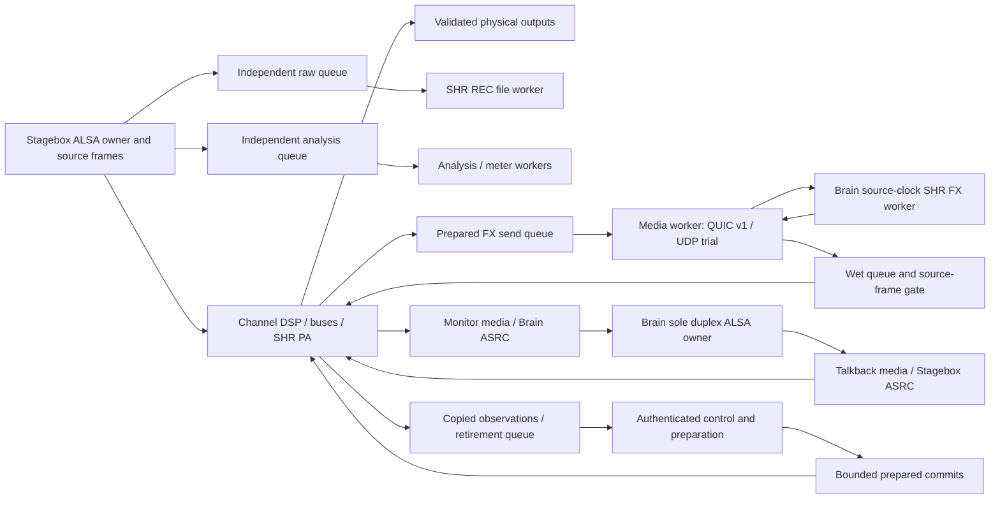
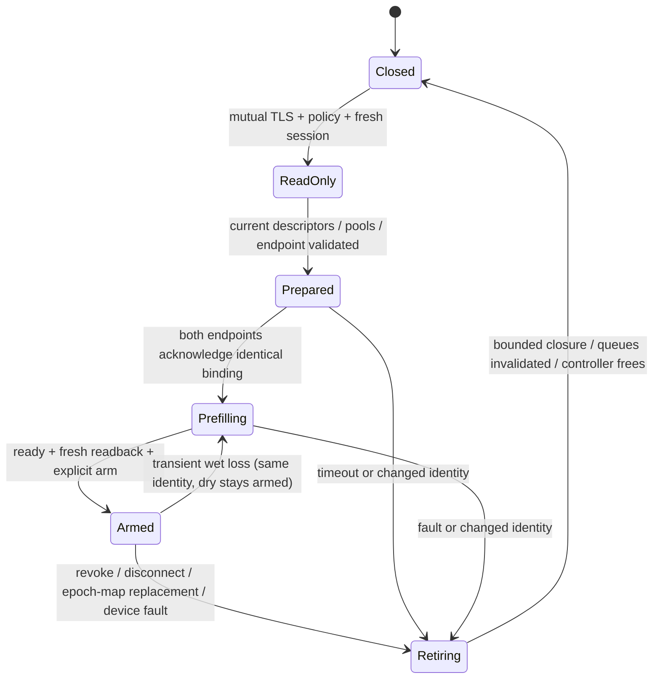

# Minimal dedicated-link audio transport blueprint

**Source, legacy/four-aux FX, Brain duplex and analysis have isolated execution. Local T0–T2 software acceptance is complete; distributed T3 and physical qualification remain separate.**
The single implementation/acceptance owner is
[GP-H1](../development/MODULE_IMPLEMENTATION_PLAN.md#gp-h1--physical-audio-qualification).
This document defines the design; that card owns dependencies, milestones and
remaining decisions. Existing [remote contracts](../reference/REMOTE_TRANSPORT.md)
remain authoritative until an implemented change is accepted.

## Decision

Select **existing authenticated QUIC DATAGRAM with isolated audio execution for
v1**. Reuse GPA1 and GBA1 binary media, reliable GP-REMOTE control, direct ALSA and
the actual PA/FX/REC owners. Remove control serialization, analysis, recording I/O
and diagnostics from deadline-critical execution. Do not rewrite DSP or introduce
another audio server. Test direct UDP behind the same media boundary only if it
can demonstrate an advantage; the conditional UDP profile below is deliberately
small and reversible.

This challenges only the direct-UDP part of the starting hypothesis. We already
have small binary packets, direct device adapters, source-frame timing, authenticated
control and bounded render libraries. Remaining combined-load timing qualification
concerns application scheduling; there is no demonstrated Ethernet loss or capacity
problem. Replacing QUIC before
fixing the shared execution would confound the comparison and add a security
migration. The v1 choice is a minimum-change decision, not a claim QUIC is faster.

| Path | Work and demonstrated relevance | Decision/change trigger |
|---|---|---|
| QUIC DATAGRAM, stronger isolation | Reuses deployed TLS identity, permissions, codecs and recovery. Still has transport scheduling, shared congestion state and internal allocation; isolate these from DSP and measure them. | Selected. Retain if combined timing passes with margin and no repeatable UDP advantage. |
| Direct UDP, GPA1/GBA1 | Reuses codecs and gives explicit socket ownership and bounded polling; removes Quinn scheduling/congestion machinery. Does not remove source/control/ASRC contention. Bare UDP loses authenticated, confidential media. | Conditional comparator, synthetic only. Consider replacement after matched isolated trials and a separately reviewed security-preserving profile. |
| RTP/UDP | Standard sequence/timestamp/payload handling and SRTP libraries can reduce work when interoperability or a maintained secure-media stack is needed. Still needs GigPies epochs, channel identities, permission/rearm binding and return deadlines. | Not v1: wrapping existing codecs adds translation. Reconsider if a qualified SRTP implementation is simpler than securing custom UDP, or interoperability becomes a requirement. |

QUIC datagrams are unreliable and congestion controlled; reliable streams do not
turn them into retransmitted ordered audio. Separate connections can reduce shared
congestion/queue coupling, but do not reserve CPU. [RFC 9221](https://www.rfc-editor.org/rfc/rfc9221.html).
RTP likewise does not guarantee timely delivery. [RFC 3550](https://www.rfc-editor.org/info/rfc3550/).

Raw Ethernet, AF_XDP/DPDK or another kernel-bypass path would add driver, privilege,
queue, portability and security work without evidence that the kernel is the
bottleneck. Reconsider only after correlated kernel/socket evidence locates a
repeatable delay there with isolated application execution. AES67 adds interoperable
media and clock requirements; it does not solve a blocked application executor or
lock an independently clocked USB card by naming source frames. AES identifies
AES67 as an interoperability standard and its clock profile as IEEE 1588 based.
[AES67](https://aes.org/publications/standards-store/?id=140),
[AES clock-profile report](https://www.aes.org/publications/standards/preview.cfm?ID=105).
Neither commercial network interoperability nor network clock distribution is
required here.

## Inspected baseline and limits of evidence

Historical planning inspection on rpi5 found clean GigPies
`97a7949b06297ffc8f13f27bfc496f2a0f5a4585`, not an assumed checkpoint.
All 13 local canonical heads and manifest-listed lock/toolchain hashes matched.
Read-only SSH through `gigpies-pi4` confirmed clean matching relevant peer heads:

| Owner | Inspected revision on both nodes |
|---|---|
| SHR Desk | `383d0f5c40827f12c044981fbae279488ea130ec` |
| SHR PA | `5f487d5118b7ddc236ee2ed222aacdf3e9ffbe96` |
| SHR FX | `e01d3aa89a908c7ef12b0b4430e2ff1cb2b13998` |
| SHR REC | `1038785883bc5fa7b6e5d5f4be4a65824152c2c4` |

Private exchange checkout, hub main and peer checkout matched
`26acd3ec8816e6a8e1e29a744d5ed9ad70f7f7d1`; no pull or source synchronization was
needed. Runtime artifact hashes in task0026 are historical receipts, not freshly
revalidated binaries. Rebuild/reverify before another experiment. This task ran
no audio/network-load experiments and made no host changes.

Private task0026, final receipt/acknowledgment and concise Ethernet results remain
in the ignored lab ledger. GP-H1 retains the public findings: same-load 5/30/60 s
passed; combined Desk/duplex passed functional/sample checks but failed timing:
89,986 returned = 89,963 admitted + 15 host-late + 8 earlier refusals, with zero
unaccounted packets and NIC/UDP errors. Shared-executor blockage, source catch-up,
diagnostic page faults and reconnect churn were contributors; remaining combined
scheduling/queue interference has no single proven cause. The 768-frame deadline
and 60-second synthetic-provider cap are unchanged. No private reports, keys,
addresses, sample dumps or recordings are copied into this design.

## FX refusal diagnostic coverage

The four-aux owner records numeric refusal causes for idle commit expiry,
cancellation and closure as well as native processing and transition faults.
Formatting stays on the controller; the execution report retains the native code.
The idle regression uses the actual owner without source blocks or controller
service. Missing witnesses could produce a generic boundary-refused message. The later
local input/output queue-drop and source-gap mechanism is now closed: media
reserves native output capacity before accepting input and releases it only when
wet output is consumed. A deterministic burst/withheld-output negative control
reproduces the old four-input/four-output-drop signature and exact source gap;
the reserved path preserves contiguous frames with unchanged four-block lanes.
The shared stereo/four-aux path retains source deadlines, native refusal witnesses
and nonblocking execution. See GP-H1's native-window correction for regression
and actual-owner evidence. This local fix does not establish physical or combined
T3 timing acceptance; completed local T0–T2 evidence stays in the owning card.

## Source-owner integration constraint: active PA live-EQ preparation

The active-owner dependency has an implemented detached-context interface in
SHR PA, authorized by the user on November 4. The original EQ v1 prepare call
borrows the active graph during JSON parsing/coefficient allocation, and tokens
bind to its unique instance. Concurrent use or preparation on a shadow instance
cannot preserve that contract. Its original readback also serializes active state.
Those interfaces remain available for compatible synchronous hosts.

The additive `shr_pa_eq_context_v1_*` interface instead creates opaque context
storage on the controller. Source-side capture copies exactly two selected input
identities, fixed-size current/target settings, fault/progress and owner instance,
generations, epoch/frame without allocating or destroying storage. Transfer the
context exclusively to the controller before preparation or readback; neither
operation then accesses the active graph. A context is not a reservation. The
unchanged native apply operation rechecks owner identity, generations, epoch,
exact frame, fault and retirement occupancy. Token disposal stays off-thread.

GigPies `host/pa_v2.rs` loads the complete optional interface and routes production
`prepare_eq`/`eq_readback` through it when available. Old libraries retain their
synchronous path; they cannot qualify independent source execution. The wrapper
exposes separate context allocation, bounded capture and detached preparation,
plus a prepared retirement slot and bounded native retirement transfer. Exclusive
`Send` ownership is documented for PA, prepared graph/EQ tokens and contexts;
no concurrent active-handle access is allowed. ModuleGraph now keeps an API-only preparer and owned observation/context packet.
Its source captures numeric PA status/context and returns retired EQ ownership into
reserved storage; controller preparation/readback uses the detached packet. Old
libraries retain synchronous compatibility. Packet transport is still a synchronous
compatibility pump, not the global admission/observation lane. This removes the ABI
constraint but
**does not complete the dedicated Stagebox/source owner**.

Owner regressions cover unchanged readback, context survival after active render
and destruction, reordered selected inputs, stale instance/generation refusals
and repeated allocation/destruction-free capture. A GigPies actual-library test
prepares/readbacks on the controller while a separate thread renders the real PA,
then checks exact-frame apply, occupied retirement refusal and stale-token refusal.
This is PA interface evidence, not complete source/PA/FX/REC stall acceptance.
The current private artifact receipt is `user/node-lab/gp-h1-modules.json`, with
source hashes for the uncommitted PA candidate in `gp-h1-pa-owner.json`. Historical
task0026 manifests are preserved and do not describe the rebuilt library.
Current local T0–T2 acceptance is recorded in GP-H1; T3 remains review-only.

## Source acquisition ownership

Production LocalAudio startup transfers measurement capture, spectrum acquisition
and analysis taps into SourceRouting. Spectrum's existing FFT worker and locked
readback remain controller-owned; acquisition carries fixed windows and atomic
selection/expiry only. Analysis acquisition carries atomic liveness/loss signals,
not the service's join handle. Measurement moves preallocated capture storage over
single-slot admission/return lanes. Completion is retained without a control pump;
new capture admission remains blocked until storage is returned. Cancellation,
source invalidation and controller teardown fence queued/active capture via a
separate monotonic generation. Source offers only copy samples/update numeric
progress; controller code validates authority/basis and retires returned buffers.

These acquisition lifetimes are independent. The completed production scheduler
is described in the local T0–T2 acceptance section below.
RenderGraph now owns mixer, modules, routing and local aux storage together.
LocalAudio's compatibility caller transfers this aggregate for each quantum.
Mixer completion now returns owned retired storage and exchanges preallocated
numeric observations with the controller. Snapshots and processing/send readiness
use the last observed coefficients/configuration; unobserved application does not
advance authority/readback. Numeric gate capture leaves logarithmic presentation
on the controller. The offline compatibility pump still observes the boundary
sample; production observes the completed quantum. These are mixer-only changes.
LocalAudio handles controls/preparation, returned module observations and replies
on the controller. Compatibility callers rendezvous synchronously with the source
executor; the production remote runner services control separately from source
pacing. Duplex transfers its prepared device to that owner; capture starts after
installation and controller preparation cannot consume active device headroom.
Authenticated proxy teardown shares a terminal atomic signal with render policy
fences; disconnect/drop closes existing fence consumers without mailbox
service, even with saturated command ingress. Client close/drop, terminal media
or control errors and FX reply-reader cancellation also publish that signal.
Reliable completion draining remains independent of audio closure. Fresh
authentication creates a new signal and never reopens the old one. Whole-Stagebox
closure is implemented by the completed source-owner continuation below.
LocalAudio now invokes one numeric `local_audio/source.rs::RenderGraph` entry
covering mixer, local aux FX, PA/local FX/raw REC, talkback, taps and acquisition.
Controller authority, lifecycle, observation exchange and reply work sit outside
that entry. Capture mapping, measurement acquisition and playback patching now
run in the same owning entry. HostAuthority transfers this graph and HostSourceMedia
to one `gp-source` worker; both remain exclusively owned there across quanta and
structural operations. Other LocalAudio compatibility callers still reattach.
The production runner now starts a bounded autonomous source owner at frame zero.
Its timer services controller observations/lifecycle and mailboxes, without
submitting capture quanta. Synthetic capture/render/media advance on `gp-source`;
physical Duplex storage transfers there with nonblocking partial-transfer cursors,
48-frame capture, source-owned device start, capture-anchored playback expiry and
validated map checks.
This physical code path is implemented but has not been activated or qualified.
Occupied numeric/retirement lanes cannot stop source progression or terminal
closure. Buffers/device/report storage return for controller destruction. Synthetic epoch recovery closes and drains the old clock, reconstructs on the same
worker, and restarts disarmed within the original absolute run deadline. Physical
reopen still requires separate device revalidation.
Diagnostic stage 38
reports controller dispatch resources and explicitly excludes worker CPU/faults;
historical inline-owner stage 37 is not reused for those measurements. A scoped-worker test exercises the same numeric entry with
actual PA/FX/REC for 32 quanta, exact samples and allocation/destruction guards.
It does not establish global admission or whole-source closure/stall acceptance.
ModuleSource owns numeric PA commits/mute/rearm and fixed-size PA/FX observations;
controller health uses the captured observations. Structural metadata is retained
on the controller. A bounded owned module packet carries REC activation/Stop,
observations and native EQ/structural retirement; finalization/destruction stay
controller-side. Returned EQ slots are emptied there before reuse, so successive
edits cannot mistake already-transferred retirement for source-owned storage. Finish a structural PA commit before preparing the next context
exchange, or a future fused command must explicitly swap the new context into it. HostAuthority now always extracts the bounded
source-egress sample endpoint. Encoder handles and joining stay on the controller;
authenticated mailbox negotiation transfers the sole encoded-packet consumer to
the network worker. Packet conversion/draining no longer needs controller service. HostSourceMedia groups wet jitter/gates, talkback ASRC and source taps/egress.
Monitor sample publication uses a prefaulted SPSC lane; encoding moved to media
polling. Its retained 64-block capacity is 49,664 payload bytes, not acceptance of
the proposed four-block profile. Full publication refuses/counts the newest block.
Media ingress now crosses prefaulted fixed Copy lanes: 256 wet datagrams and
receipts, 64 talkback mono blocks and receipts (671,296 payload bytes on this
64-bit target, excluding ring metadata). Source insertion rechecks policy fences,
negotiation generations and exact deadlines; receipt saturation stops draining,
not rendering. Full ingress refuses/counts newest items. Controller receipts own
hashing and acceptance accounting. Closure also fences buffered wet playout.
These lanes are additional bounded storage, not global resource admission or a
larger playout window. Media negotiation prepares storage on the controller and
swaps it through owned commands on the shared source worker. Displaced bridges,
queues, policy fences and egress storage return to the controller. Readback uses
copied numeric state. Policy/readback admission and host orchestration still
depend on controller progress.

Detached mixer commands/completions and external structural permits now bind
owner, epoch, exact frame and ticket. The shared reservation retains admission
order until source completion; refused/replaced storage returns for controller
destruction. Revocation before application produces a numeric cancellation;
revocation after application preserves the actual applied revision without
restoring the writer's grant. Source rendering continues while an observation is
retained or after export. Terminal source/controller teardown and ticket cancellation have independent
atomic signals. The global worker now has 16 prepared-command slots, 128 numeric
completion slots and 16 retirement slots. It reserves both return lanes before
removing a command or swapping storage; returned packets retain native owners
and allocating payloads for controller destruction. Controller calls serialize
one outstanding transaction with a controller-only mutex; the worker never
locks it. These bounds have local saturation, session/lease closure and reconstruction
coverage, including actual-owner and authenticated combined cases. Controller safety/quiescence now uses
a copied output envelope; patch preparation uses controller topology and publishes
the applied map from returned ownership. Operator taps and prepared aux storage/
sends travel in source commands. Local aux retains active Rack owners in the graph,
with instance-free controller preparation and fixed status/native-retirement return.
Terminal source quiescence exchanges module retirement without requiring another
capture block, so raw REC finalization is not stranded by persistent detachment.
Monitor/send/aux and bus samples are copied into controller observations.
Applied aux send targets use a further preallocated `32 * inputs` bytes per mixer
observation; remote aux queries/acknowledgments consume them only after source
completion, not from a queued command or active mixer. Routing reset, startup
rearm, terminal mixer quiescence and terminal module exchange now use owned
commands. Epoch recovery retires the quiesced graph, rebuilds it on the controller
and reinstalls it on the same worker. The autonomous synthetic lifecycle now
coordinates this stop/rebuild/restart and preserves the old report even if restart
fails; it never transfers old grants, media identity or automatic rearm.
Graph and reusable quantum storage are boxed to keep Host construction within
the default thread stack; no larger stack is required by the owner tests.

Source-issued admission binds owner, epoch, exact frame and a monotonically
increasing ticket. A future reservation does not change observed readback or stop
unchanged source rendering. Late/superseded packets refuse before mutation and
retain their payloads. Future mixer mutations retain validation across installation
at F and application at F+48 without a second controller pump. In the bounded
clock-owner API, ordinary engine dispatch reserves F=current+480, prepares while
unchanged rendering continues, and retains the globally ordered packet until
completion. Expired packets refuse without application. Delayed commit rechecks
monotonic lease expiry and the authenticated session/policy fence; exchanged
fence storage is destroyed on the controller. Reply storage is reserved before
preparation. Copied talkback lease/hold and monitor freshness deadlines expire
locally. Hold/FOH policy fences remain independently bound to their authenticated
control sessions, including when speech comes from another live media session.
Monitor generation changes silence stale selection at the source boundary and
limit retirement to 250 ms / 12000 frames. Queued monitor blocks are also silenced
before encoding after a selection change; terminal clock closure retires that
queue. Structural/local-aux/Brain commands use the same future-boundary preparation,
authority expiry and retained storage discipline, including Brain device
configuration intent. Structural completion precedes preparation of a new PA context. Media negotiation swaps prepared storage
at a future source frame and refuses expired/closed packets without replacing the
controller identity. Remote FX permission now uses a source-issued future boundary.
Four-aux sends retain prepared storage until the negotiated later source frame,
with independent writer/owner fences, cancellation and expiry. Controller receipt
processing retires the storage and distinguishes permission from source/Brain
application. Four-aux negotiation swaps send mode and prepared media in one
transaction with both returns reserved before mutation. Service exchanges current numeric observations and REC lifecycle
without advancing source time; final observation follows stop. Media cumulative
counters are sampled as deltas, including final accounting. Source-owned output
windows preallocate at most 600 synthetic / 2048 physical rows, each covering
at most 4800 source frames with per-output peaks/energy and wet totals. Rows split
on actual source-applied revision/map, remote aux application ticket/frame and
Brain routing/hold state changes. `identity.remote_fx_applied` is the last
successful `[ticket, source_frame]`, distinct from the earlier permission revision;
a refused send packet never publishes this identity. Prepared
window storage is `min(blocks, cap) * (size_of(SourceOutputWindow) +
16 * playback_channels + monitors)`, excluding allocator metadata. Overflow retains
a contiguous evidence prefix and aggregate totals remain exact. `source_clock_v2`
places correlated identities in `source_report.output_windows`; the old
controller-sampled revision/Brain histories remain null. Legacy shape isolation,
independent analysis and combined authenticated lifecycle coverage are implemented;
the owning card records final local validation and the separate T3 timing gate.
Acquisition-only tests do not establish whole-source stall, PA/FX/REC lifecycle
or realtime acceptance.

## Baseline execution before owner extraction

Paths are relative to the GigPies root. These are static source observations,
not a new timing profile. Existing bounded DSP sections must not be confused with
the larger allocating controller/pump around them.

| Path at the inspected revision | Execution and interference |
|---|---|
| `src/bin/remote.rs::runtime` → `remote/runner.rs::run_config_authorized` | Calling thread runs the provider/FX future; two Tokio workers run spawned networking/control. Synthetic source uses 1 ms Burst ticks and up to 100 ms debt before fault. This already fixes the original single-executor blockage, but catch-up can compress return headroom. |
| Provider loop → `AuthorityMailbox::service` (`remote/proxy.rs`) → `HostAuthority::dispatch` | Before each source block, every session can dispatch 16 commands and poll 32 completions **before** draining 64 wet packets, 64 Brain packets and each outgoing lane. Sixteen sessions multiply this bounded work. JSON, snapshot construction and preparation run on the source orchestration thread. A bounded count is not a bounded execution time. |
| `HostAuthority::process_source` (`remote/host.rs`) → `LocalAudio::tick_with_capture_and_brain` → mixer/module graph | Source owner pops wet jitter buffers, gates wet, services FX/device intent, renders PA/local buses and publishes completions/monitor/analysis/FX packets. `encode_grouped` allocates vectors and outgoing packets; analysis and FX share the 256-entry outgoing deque (oldest removed on full). Raw capture precedes channel processing. LocalAudio is explicitly controller-side, not a realtime callback. |
| `remote/session.rs::ServerSession::run_inner` | Reader/writer tasks use request/reply mpsc capacities 8/32. One select loop handles commands, incoming media and a 1 ms ticker; ticker drains replies before Brain and GPA1 media. QUIC buffers each direction at 256×1232 bytes. Control and media still share scheduling and connection resources. |
| `remote/proxy.rs::authority_channel` | rtrb SPSC: 16 commands, 128 completions, 256 GPA1 packets per direction, 64 GBA1 per direction. Entries contain `Vec`/JSON, so preallocated ring slots do not eliminate payload allocation/destruction. Some outgoing full-queue paths discard without a dedicated outcome counter. |
| `remote/brain.rs::BrainWorker::step` | One media receive handles analysis and FX. `GroupedReceiver` uses BTreeMap/BTreeSet and newly allocated sample vectors for up to 32 partial blocks. Completed FX calls actual `BrainAux`/`BrainFx`, encodes return vectors, hashes samples and sends. Runner also handles control/observations and analysis sample comparisons on this future. |
| `src/bin/brain.rs` → `brain_runtime.rs` | Current-thread Tokio runtime. One select loop combines 250 µs device service, 25 ms control, awaited control writes, monitor receive and negotiation. Capture packets allocate; fake playback windows still build JSON during the run. Both ASRC state and local duplex callbacks are here. This is an additional interference path, not proof it caused every failed packet. |
| `host/duplex.rs`, `host/device.rs`, `brain_audio/{host,device}.rs` | Explicit raw ALSA ownership, validated slots and partial transfer cursors. Stagebox orchestration can wait on device I/O and services authority between capture and render. DSP callbacks themselves must not do I/O. Brain service makes bounded nonblocking calls; its outer runtime remains shared. |
| `host/adapters.rs::Recorder`, owner module graph | SHR REC owns filesystem worker/finalization; host push is separate from network. Current adapter requests 256 blocks and checks its queue against 64 MiB. Owner lifecycle creation/drop/join is not safe to move into render. |
| `remote/policy.rs`, diagnostics and runner evidence | Policy uses `Arc<RwLock<Policy>>`; dispatch/current-policy checks can acquire it in source-side orchestration. It is not inside the core mixer. Numeric traces are bounded/prefaulted, but optional stats/resource calls, hashes, snapshots, window clones and final serialization still have costs. TLS/Quinn locks/allocations stay in transport workers; their internal timing is unqualified. |

## Local contract reconciliation

The continuation runs on `d4adff4239b71e143e9a33e8105d5a0624fb5e9f` plus the
preserved unstaged work. The historical source manifest above is not a receipt
for this tree. Local PA/FX/REC library/header/owner-manifest hashes were rechecked;
no new two-node or physical acceptance is implied.

`tests/audio_transport_v1.rs` supplies independent literal GPA1 PCM24/FX-send/wet and
GBA1 talkback/monitor vectors. It checks every truncation, reserved/identity
bytes, nonfinite samples, disabled roles, strict wet deadline equality, sequence
wrap, exhausted frames, grouping at multiple payload ceilings and 16/32/48 inputs.
The existing transport and remote suites retain permission, stale/replay, map,
reconnect and rearm coverage. These vectors are authored independently of the
encoder, but are not an independent-person protocol review.

The GPA1 codec supports arbitrary initial sequence numbers (legacy callers use
that contract); `encode_grouped` derives sequence from frame. Do not tighten the
shared parser to the v1 producer formula without versioning that distinction.
`MediaRegistry`, proxy prefilters and source `JitterBuffer::insert_wet_at`
reject deadline equality. Registry deadline rejection precedes replay-window
mutation. Passing a prefilter is not final admission. GBA1's negotiation generation deliberately does not appear on wire:
only role generations do, preserving monitor continuity through PTT changes.
The configurable palette FX owner has algorithm-dependent delay; 960 frames is
the fixed legacy delay owner, not a universal four-aux effect delay.

The first bounded-ingress changes retain existing queue capacities and scheduling:
proxy GPA1/GBA1 ingress holds inline `Copy` datagrams, with no heap payload freed
on dequeue or overflow; all four proxy lanes expose overflow counters independent
of tracing. Outgoing packets still allocate in the controller. At the present
1234-byte inline size, 256+64 ingress slots consume 394,880 payload bytes/session,
or 6,318,080 bytes for 16 sessions, excluding ring/shared metadata. This is an
explicit aggregate cost, not the proposed role-only four-block pool admission.
The provider's `media_queue_drops` report now sums all four lanes across its
entire run, including retired sessions. Each producer increments a shared fixed
ledger directly; no per-session records accumulate and retirement cannot race a
last mailbox snapshot. Final totals are sampled after network tasks have joined.
`GroupedReceiver::push_into` uses 32 prepared sample slots and a 64-bit group
bitmap, copying a completed block into prepared Brain input storage. Eight
48-frame FX channels use 98,304 sample bytes for assembly plus 3,072 input bytes;
slot tags/specs are additional. The compatibility `push` API still allocates for
non-audio callers. Allocation/destruction guards cover `push_into` success,
duplicates, stale data, shape refusal and full assembly storage.

`AudioPayloadBudget::checked` measures the proposed profile's payloads, not the
current runtime or RSS. With 16 inputs, eight FX channels and eight independently
allocated packet windows it gives 2,241,536 bytes: FX handoffs 49,152, packet
windows 315,392, duplex handoffs 9,216, ASRC samples 98,304, REC 1,572,864 and
analysis 196,608. Duplex handoffs count both sender and receiver on both crossings;
the previous 4,608-byte figure omitted one end of each crossing. Window count must include each allocated instance across nodes;
callers must validate each descriptor's group count. All arithmetic is checked;
REC remains limited to 64 MiB. Metadata, ASRC coefficients, owner engines, TLS,
trace buffers, stacks and process overhead require separate accounting.
`JitterBuffer::prepared_storage` and `GroupedReceiver::prepared_storage` report
their actual requested Rust layouts, including slot tags/alignment, spec capacity
and sample allocations. `PreparedStorage` checks addition/overflow. These counts
exclude allocator overhead and are not a complete process or aggregate budget;
TLS, owner libraries, ASRC and other execution domains remain unaccounted here.

The source now offers GPA1 analysis/FX samples through four reusable prepared
blocks to `gp-source-encode` (`remote/source_egress.rs`). Encoding allocations
and packet destruction run on that worker; its 256-entry output lane contains
inline datagrams. Authenticated negotiation transfers its sole packet consumer
through the bounded proxy event lane to the network worker, which converts packets
to the existing transport API without controller service. A mutex serializes only
network packet draining with controller shutdown; rendering, source closure and
encoding never acquire it. Shutdown joins encoding, drains and destroys the ring
on the controller even if the detached endpoint remains alive. Source offer and terminal closure neither wait nor
allocate/free. Session replacement prepares a fresh descriptor, joins the old
encoder on the controller, and retains cumulative numeric counts. Closure
prevents old queued packets from being drained; shutdown counts unconsumed packets
and discarded source blocks separately from full-lane drops and encode refusals.
Requested sample and ring-entry layouts use checked arithmetic; their report
explicitly excludes descriptor/queue and shutdown-mutex metadata, thread stacks, encoder temporaries
and allocator overhead and is not RSS. Legacy combined descriptors still share this media path for compatibility.
The production Brain runner now uses a separate analysis-only authenticated
connection and `gp-analysis-media` runtime. The source installs an independently
fenced observer and `gp-analysis-encode` worker with four reusable sample blocks
and the existing 256-packet lane. This is a bounded four-block implementation of
the proposed analysis profile, not a claim that the proposed 32-block pool exists.
A single analysis observer is admitted, and its connection cannot attach FX or
duplex. Separate connections still use the provider's existing network runtime;
provider runtime sharing is explicit in local accounting; sustained headroom
qualification remains T3. Authenticated wet
ingress now transfers a prepared generation/stream endpoint through that same
bounded event lane and submits to the existing source queue without controller
service. A source-published atomic cursor keeps network late/future filtering
independent of controller observations, including with full receipts. Source
checks remain authoritative; receipt hashing/accounting stays on
the controller. A producer mutex coordinates compatibility/network submission and
final closure only, never rendering. Receipt saturation still defers insertion.
Brain media still traverses controller mailbox service. These handoffs do not
establish complete cross-owner or timing acceptance.

The production mixer transaction path uses controller preparation, owned render
state in `mixer_control/source.rs`, and controller completion. `prepare_render`
validates one globally reserved mixer/processing/send transaction and retains staged
authority. The source state owns the actual Mixer, numeric epoch, plan and receipt;
it replaces the borrowed `PreparedRender`. After an admitted mutation, unchanged
quanta can continue while its receipt/retirement is occupied. Unvalidated pending
and external boundaries remain explicit fences. Rendering neither constructs
replies nor destroys prepared storage. `finish_render` retires storage and installs
applied authority; production readback describes the latest completed quantum and
`effective_frame` retains the exact application sample. The synchronous offline
API retains its historical boundary-sample snapshots.

`module_graph/source.rs` owns the actual PA and local FX engines, raw recorder
push handle, source timeline, buffers and PA retirement storage. Its render method
is the method used by ModuleGraph/LocalAudio, not an alternative implementation.
Recorder metadata, observer, library loading, preparation and finalizer threads
remain in ModuleGraph. A source-side numeric cancellation latch survives delayed
controller observation; preparation cannot activate a recorder after a source
fault, and Stop/recovery retain the original cancellation cause.

`local_audio/source.rs` now owns the prepared capture/playback/raw/bus/PCM
scratch, PA silence, talkback samples and envelope, monitor/send taps and meter
acquisition. Production LocalAudio delegates capture permutation, output patching,
pre-talkback monitor/send taps, talkback rendering and monitor talkback summation
to this storage. Meter `Latest` readback stays on the controller; the existing
bounded acquisition lane is unchanged. Talkback continues to use the existing
renderer, with source envelope reset on fault and restored intent. Measurement capture and spectrum acquisition are source-owned; analysis, FFT,
readback and worker lifecycle remain off audio. Independent analysis uses the
separate connection/runtime and encoder described above.

RenderGraph and HostSourceMedia share a
dedicated executor; the production runner now starts autonomous synthetic/physical
capture progression while servicing controller preparation and observations
separately. Future structural/local-aux/Brain packets and ordinary mixer commands
reserve returned storage before mutation; late packets cannot publish application.
Actual PA/local-FX/raw-REC tests exercise the production runner lifecycle helper
under stalled controller and saturated return lanes, with exact raw tails and
fresh-epoch rearm. Remote FX/aux source-boundary integration and synthetic
autonomous reconstruction extend that path. Combined authenticated lifecycle,
independent analysis and local resource accounting have passed T0–T2 acceptance.
Distributed clean timing/headroom and physical activation remain separate T3/GP-H1 gates.

`BrainAux::process` now swaps prepared configurations and retains the displaced
storage in its occupied pending slot until controller polling. Refusal retains
unpublished tokens and request storage; cancellation/reclamation happens outside
`process`. Bounded owner query/reset/publication wrappers return static/numeric
errors without allocating. Preparation refuses while that completion/retirement
slot remains occupied. The compatibility `BrainAux` entry points retain serialized control/render
separation in one outer worker. The production four-aux runner now uses the
independent execution boundary described below. The actual-library
host allocator guard covers commits, unpermitted edits, source gaps, panic and
invalid shape/exhaustion; it does not intercept allocations inside the dylib. The earlier T2 duplex loop shared control awaits. No dedicated execution, prepared-commit closure or safe
retirement claim follows from inline ingress or fixed assembly. The inspected
SHR FX palette ABI explicitly permits separate preparation and ownership transfer;
no sibling ABI blocker has been established. The palette wrapper now supports that transfer with serialized instance calls
and off-thread cancellation. The stereo delay path now uses the same media boundary
and a separate source-frame executor described below.


The current continuation wires `brain_runtime::run` to a sole `gp-brain-duplex`
service thread and a separate `gp-brain-media` network thread. The controller
retains device intent/epoch persistence, negotiation, JSON and playback evidence.
Service owns BrainHost and the existing monitor ASRC bridge; Stagebox talkback
ASRC is unchanged. Each capture/monitor lane has four fixed blocks. Ordinary
state commits are copied (one per service quantum); atomically published capture/monitor closure generations
bypass that lane. An expired local deadman closes output and requires observed closed state
followed by a later active revision; an unrelated newer revision cannot rearm. Service independently enforces one absolute run deadline shared by initial
preparation and every replacement; an expired replacement cannot service audio.
Replacement stops and joins the old owner before opening a new epoch; the existing
acknowledged-closed-readback and explicit-arm fence remains in the controller.
Numeric status includes applied revision, closure generation and lane drops.
No audio-owner lock, control await, packet encoding, hash or JSON occurs in service.
The media worker retains BrainMediaChannel authentication and replay checks.
It may retain one additional capture block while the accepted negotiation generation
changes ahead of its copied route update; this slot is bounded and counted as stale
on shutdown if not sent.

Local validation covers actual BrainHost/Bridge service ticks under
full copied-state and observation queues, closure and expired-revision refusal,
nonzero monitor playback with zero deterministic bridge under/overflow, and a
host allocation/destruction guard. Authenticated loopback execution during
controller stall, both complete normal suites, verified actual-owner cases, all
five accelerated bridge opt-ins and hardware-host all-target Clippy passed; see
GP-H1 for final counts and measured resource limits. Local aggregate accounting
reports actual known layouts and process/per-thread observations with explicit
opaque-storage exclusions. T0–T2 local acceptance is complete; sustained aggregate
headroom, two-node timing and physical qualification remain separate.

## Stereo delay execution

The production runner extracts every admitted legacy `BrainFx` shape (1..256
channels, 48 or 96 frames) into `remote/fx_execution.rs`. The `gp-brain-delay` thread alone calls native process,
commit, panic, reset and bounded status. The shared `gp-fx-media` worker assembles
and encodes the negotiated payload; it does not run DSP. Four reusable sample
blocks are sized from the actual topology. The native owner uses one prepared
output scratch and returns the input storage as wet storage; the media owner
recycles it only after encoding. Exceptional full-output storage is retained until
controller teardown, never destroyed on the native worker.

Controller preparation pins the loaded library and creates an instance-free delay
token. Commit borrows that token at the exact source frame; a reserved retirement
slot returns it for controller destruction. Four-block sample lanes, sixteen
command/retirement slots each and 128 copied numeric observations bound the
handoff. One outstanding protocol transaction remains the admission limit.
No controller JSON, native preparation, native destruction, network operation or
hashing runs inside source-frame execution. Normal shutdown joins the worker and
returns its active owner and remaining storage for controller destruction.

Permit and cancellation identities, session/policy closure, request expiry and the
absolute run deadline are checked independently of controller polling. Idle
service refuses expired/closed pending work without another source block. Filled
observation lanes retain completion for retry; settled completion preserves its
numeric application status across later closure. The runner shares one absolute
deadline between execution and its control loop. These ownership changes do not establish whole-source timing or physical
qualification. Separate analysis and resource reporting are described above.

## Four-aux execution continuation

The production four-aux runner now extracts `BrainAux` into
`remote/aux_execution.rs`: `gp-brain-fx` exclusively calls the four actual palette
instances; `gp-fx-media` owns authenticated `MediaChannel`, prepared assembly,
wire encoding, hashes and analysis fanout. The controller keeps JSON, configuration
validation and instance-free preparation. Four-block Copy lanes carry the fixed
48-frame/eight-channel aux map. Sixteen prepared commits, sixteen completed commit
objects and sixteen transferred native tokens bound ownership retention; a commit
is consumed only when its retirement slot is available. The existing one-pending
control transaction remains stricter than those physical capacities.

Copied numeric observations use a 128-entry ring with counted drops. This is the
actual implementation layout, not the proposed two-slot state publication profile.
Preparation pins the same library with an Arc and uses copied settings. Publication,
status and native retirement transfer stay serialized on the FX thread; token
cancellation and instance destruction occur on the controller after ownership
transfer/join. A separate atomic closure bypasses ordinary commits and stays closed
until a new execution owner is created. An authenticated policy-generation fence
is also checked on every quantum without taking the policy lock; policy replacement
publishes that fence before returning its acknowledgment. Filled observation lanes
retain the latest completion for bounded idle retry, including when media stops.
Ring entries are touched before readiness. Every quantum checks the absolute run
limit; the runner's existing synthetic/physical duration admission is unchanged.
No priority, affinity or host configuration changes are made.

Actual-library testing has exercised processing through controller stall and
observation saturation under a host allocation/destruction guard. The authenticated
loopback four-aux test uses this production wiring and a 768-frame wet deadline;
accepted wet returns continue during a 100 ms controller stall. These checks do
not isolate the Stagebox controller, test two-node timing, or qualify hardware.
All admitted legacy channel/block shapes now use dedicated execution. Actual-owner
sample comparisons cover 48/96-frame banks at 1/2/3/16/48/256 channels. Combined
authenticated lifecycle and separate analysis now have local acceptance coverage.
The reported FX queue layout
excludes native owner storage and process costs; it is not an RSS measurement.
Assembly is transferred to the media owner rather than duplicated. The runner
reports its exact prepared assembly layout separately and samples process
RSS/peak RSS, CPU and faults at controller readiness and after shutdown. These are one
process's observations, not aggregate-system or steady-state acceptance.

## Proposed owners and bounded handoffs



Execution domains are dedicated threads, not just ports. Stagebox has one source/
render owner and a controller thread; Brain has one FX owner, one local duplex
owner, and controller execution. Network workers may allocate internally, but
never block an audio owner. Analysis, snapshot/JSON serialization, record lifecycle,
file I/O and report generation have no access to an audio-owner mutex. Desk opens
no PCM. Keep existing separate FX and duplex processes initially; do not merge
executables merely to share a socket.

The controller owns permissions, leases, replay state and prepared graphs. It
publishes fixed typed commits carrying exact source/map/revision/policy-generation
fences. Audio applies at most one ordinary commit per 48-frame block, rechecking
numeric fences. Policy revocation/disarm is a separate non-droppable atomic
closure generation checked every block, never queued behind edits. Publish
revocation before acknowledging it. Expired/deadman commands fail closed on the
audio owner's local monotonic time, even if the control worker is stalled. No
payload grants authority. Applied state changes only at the audio boundary;
controller readback is assembled from copied state/revision, not by concurrently
reading the live mixer. Retired storage is returned for controller destruction.
If retirement capacity is unavailable, refuse a new prepared swap before commit.

Preallocate and touch all audio-owned payloads, rings, assembly bitmaps, filter
state and diagnostic slots before readiness. Use indices into owned pools or
Copy blocks; never drop the last allocating reference on an audio thread. No
JSON, hashes, strings, sockets, filesystem calls, mutexes or unbounded drain loops
in render. The sole device thread performs ALSA service outside its render section;
one period's physical submission deadline includes that orchestration. Do not call
the existing whole LocalAudio/HostAuthority pump allocation-free after merely
moving it to another thread.

Proposed initial resource profile (reject setup if any checked sizing fails):

| Handoff/storage | Capacity and owner | Full, stale or failed behavior |
|---|---|---|
| Source → FX network; network → FX owner; FX → return network; network → source wet | Each SPSC holds **4 complete 48-frame blocks**, with configured FX width. Network assembles packets in **32 slots/group**, fixed bitmap; no BTree allocation. Audio admits at most 4 blocks/lane/quantum. | Producer drops new block and counts it; consumer drains stale blocks within its fixed bound. Never overwrite a consumer-owned slot or wait. A drop fails a clean trial; wet fallback remains safe. |
| Wet playout | 32 slots/group, source-owner cursor; `D=768` leaves 16 blocks of return interval plus bounded future storage. | Refuse at/after output deadline, duplicate, wrong identity or outside window. Pop missing at its actual source-frame deadline; fade, never replay old audio. Capacity is not an extra 32 ms delay. |
| Brain talkback and monitor network handoffs | Independent 4-block SPSC lanes; 32-packet reorder windows before each bridge. | Gap/discontinuity closes affected ASRC path, bounded fade, fresh identity/prefill/rearm. Neither crossing waits for FX. |
| ASRC rings | Existing per-crossing 4096-frame initial profile, 960-frame target plus 128-frame filter allowance; mono talkback, stereo operator playback. | Keep existing controller/overflow/saturation failure semantics; do not enlarge rings to hide misses. |
| Raw recording | Existing SHR REC 256-block queue, separately sized by input width, at most 64 MiB in adapter admission. | Never block source; report gap/incomplete/fault from REC truthfully. Network/control cannot consume its slots. |
| Analysis PCM fanout | 32 blocks at configured input width, separate worker and network queue; at most one block offered per source tick. | Drop new and count gaps; consumer discards stale work to latest usable window and marks observations unavailable. No audio priority inheritance. |
| Meter/state observations | Two prepared snapshot slots with ownership handoff; consumer may skip versions. Existing meter request minimum 40 ms/session remains. | Skip publication when no free slot; report acquisition age. No writer waiting and no overwrite during reader copy. |
| Prepared commits / completion / retirement | 16 global commits, 128 completions, 16 retired objects; one ordinary commit/block. Keep per-session protocol 16/128 command/completion admission outside audio. | Refuse busy before mutation; reserve a completion and retirement slot before accepting a swap. Closure generation bypasses queue. |
| Diagnostics | Fixed counters/high-water marks always; opt-in numeric trace from existing bounded capacities, prefaulted, drained/serialized off audio. | Explicit overflow invalidates trace-based acceptance. No per-packet JSON/logging. |

Four-block handoffs allow short scheduling bursts; they are not permission for
four milliseconds at every boundary. The measured sum still must meet 16 ms.
Queue residence and complete-block age are measured independently. Socket workers
process at most one configured block's groups per lane per round, round-robin
across FX/wet and duplex; the analysis worker cannot append ahead of audio. Bound
total groups to 64 and selected channels to 256/role as existing protocol resources.
At most two admitted audio owners (FX and duplex), one analysis subscription and
16 total authenticated sessions; control-only sessions receive no media pools.

Use separate QUIC connections/endpoints for the FX audio owner, duplex owner and
analysis observer, with dedicated media runtime execution. Operator/control clients
retain existing connections; media-owner control streams carry setup/lifecycle only,
not snapshots or continuous analysis. Session-derived writer scopes stay unchanged;
new analysis attachment is read-only. This needs no new port discovery: endpoints
are explicit private configuration. Keep all sessions within the existing 16-slot
budget. The audio owner polls only prepared commits and its media lanes. Quinn
may still allocate/lock on its own runtime; those costs remain in the comparison.

Resource accounting must include **all** processes: Desk/Lightdesk, FX/PA instances,
ASRC coefficients, REC buffers/filesystem cache, TLS session windows and diagnostics.
A 4-block f64 queue costs `4*48*C*8` payload bytes; a 32-slot packet window costs
`32*1232*G` plus tags/bitmaps. REC payload is `256*48*N*8` (1.5 MiB at 16 inputs),
analysis 32-block payload is `32*48*N*8` (192 KiB at 16). Two ASRC rings' sample
storage is `4096*3*8=98,304` bytes, excluding filters/scratch. Existing enabled
provider traces alone add roughly 23 + 29.3 MiB plus final JSON; that is not total
RSS. Report exact checked prepared bytes and observed aggregate RSS, faults,
per-thread CPU, run-queue/scheduling delays and thermal state. Source completion waits park the controller and wake it after both completion and
retirement publication; the source never takes that controller mutex. Do not reserve a
busy-spin thread for every lane on four cores. Block network workers on readiness,
keep telemetry rates bounded and qualify headroom before raising dimensions.
Affinity, realtime scheduling, memory locking, governor and sysctl changes are
separate authorized experiments, not prerequisites silently installed by v1.

## Clock, packetization and latency

Stagebox's soundcard/ADAT domain supplies the authoritative source epoch and frame.
Raw REC, source analysis, channel DSP, FX sends/returns and PA remain in that domain.
The FX owner processes complete source-indexed blocks without a free-running audio
clock or ASRC. Brain duplex has its own durable device epoch and integer cursors.
Talkback converts Brain → Stagebox; selected monitoring converts Stagebox → Brain.
Retain both existing bounded Rubato bridges and their independent controllers.
[Bridge contract](../reference/BRAIN_AUDIO_BRIDGE.md).

Network clock synchronization is **not needed for v1**: wet deadlines are checked
on Stagebox frames, FX follows those frames, and ASRC reconciles the two physical
rates. Neither PTP nor NTP is used to schedule audio or to infer oscillator lock.
Source-frame labels express a processing relationship, not a common physical
sampling instant. Physical Stagebox/ADAT lock still requires observation. Never
subtract host clocks; local source-send to returned-dequeue includes two directions,
processing and scheduling, not one-way or electrical latency. Kernel timestamps
require a declared clock domain even on the same host.

Use 48 kHz, 48 frames/packet (1 ms), matching current composed host and device
period. The legacy standalone 96-frame codec is not selected for v1. Aggregating
two periods would spend more deadline margin and not solve executor stalls.
Wet packet for source `s` is due at `s+768` (16 ms); admit strictly before that
frame, matching `JitterBuffer::insert_wet_at` and the registry/mailbox
prefilters. Never increase D during comparison. The legacy delay owner's
960-frame intentional algorithmic delay (20 ms) remains a separate contribution;
the configurable palette reports algorithm-dependent delay.
D schedules a returned output block, not a claim the effect has no intrinsic delay.

Initial engineering allocation, to be measured rather than asserted: source
publication ≤1 ms; forward network/receive ≤2 ms; assembly+FX ≤2 ms; return
network/receive ≤2 ms; source ingress/admission ≤1 ms. Total ≤8 ms targets 8 ms
reserve within D. Cross-node components cannot be obtained by subtracting their
clocks; use per-node spans plus the Stagebox roundtrip and frame margin. Acceptance
requires minimum admitted margin ≥192 frames (4 ms), as well as no late packets.
If that proposed margin is unattainable, diagnose/review the design; do not silently
relax it or the 768-frame comparison deadline. These are software design targets,
not measured electrical latency or a hard realtime guarantee.

Each Brain crossing separately budgets nominal 960/48000=20 ms queue target plus
128/48000≈2.67 ms filter delay, network packetization and actual device buffering.
Readiness is the bridge's status (currently first ready packet boundary at 1056
frames), not a fixed sleep. Keep ±1000 ppm admitted skew, ±1500 ppm hard bound and
100 ppm/s slew. Submission/device-buffer tails are additional; the existing maximum
48000-frame device buffer is a safety bound, not an acceptable latency target.
Stagebox's current physical pump expires unsubmitted output one period after
capture; retaining D=16 ms does not relax that separate 1 ms local deadline.

## Exact v1 media wire profile

Reuse the existing formats. Offsets are zero-based, lengths exact; all multibyte
integers and IEEE-754 floats are **big-endian**. Magic includes the version; reject
unknown magic, role, format or nonzero reserved bytes. One datagram contains one
packet, no bundling, padding, compression or application fragmentation.

### GPA1: source analysis and FX (48-byte header)

| Offset | Bytes | Meaning |
|---:|---:|---|
| 0 | 4 | ASCII `GPA1` |
| 4 | 1 | 1 = signed packed PCM24; 2 = float32 |
| 5 | 1 | 1 = analysis; 2 = FX send; 3 = wet return |
| 6 | 2 | Channels in this group, nonzero |
| 8 | 2 | Frames, exactly 48 in this profile |
| 10 | 2 | First channel index in this role's descriptor |
| 12 | 4 | Nonzero stream ID, unique per negotiated group |
| 16 | 8 | Nonzero authenticated media session ID; **not** physical source epoch |
| 24 | 8 | First Stagebox source frame, divisible by 48 |
| 32 | 4 | Sequence = `(source_frame / 48) mod 2^32` |
| 36 | 4 | Sample rate = 48000 |
| 40 | 4 | Wet delay = 768; other roles = 0 |
| 44 | 4 | Zero |
| 48 | `48*C*B` | Frame-major/channel-interleaved payload; B=3 or 4 |

Analysis is signed two's-complement 24-bit, normalized by 8388608 when converted
to f64; encoding refuses values outside −8388608…8388607. FX float32 must be finite
and within ±16; do not clip to hide invalid samples. Convert f64 once at the wire
boundary; raw PCM24 is exact, arbitrary FX f64 is rounded. Independent tests use
float tolerances, not bit equality across a lossy f64→f32 conversion.

`MediaDescriptor` reliably supplies session, source epoch, capability/map
generations, sample rate and each stream's role/ID/first-channel/ordered stable
channel IDs/frames/encoding/delay. Validate all against owner capabilities and
permissions; no overlapping or missing role-channel indices, duplicate IDs,
unequal FX send/return width or unknown source IDs. Channel IDs identify logical
strips/aux sides, never physical slots inferred from packet order. Reconnect or
source/map replacement gives a fresh authenticated media session. V1 forbids
reusing a GPA1 session+stream tuple for a changed map, since the header itself
contains no map generation.

### GBA1: independent-clock duplex (80-byte header)

| Offset | Bytes | Meaning |
|---:|---:|---|
| 0 | 4 | ASCII `GBA1` |
| 4 | 1 | Role: 1 talkback (mono); 2 operator monitor (stereo) |
| 5 | 3 | Zero |
| 8 | 8 | Authenticated media session |
| 16 | 8 | Stagebox source epoch |
| 24 | 8 | Brain local device epoch |
| 32 | 8 | Stagebox map generation |
| 40 | 8 | Brain map generation |
| 48 | 8 | Role generation: held-action for talkback, selection for monitor |
| 56 | 8 | Selection generation for monitor, zero for talkback |
| 64 | 8 | Held-action generation for talkback, zero for monitor |
| 72 | 8 | First **producer** frame: Brain for talkback, Stagebox for monitor |
| 80 | 192 or 384 | 48 frames, mono/stereo interleaved float32 respectively |

Lengths are exactly 272/464 bytes. Rate/frames/channel mapping come from validated
`GP15-media:1` and device configuration; no implicit negotiation from packets.
Every descriptor identity field matches, roles must be enabled, and frame+48 must
not overflow. Samples must be finite representable float32 (existing GBA1 does
not impose GPA1's ±16 range); host gain/protection/clamp contracts remain separate.
There is no additional sequence field: producer frame/48 is a u64 packet ordinal
within this exact role identity. `generation` is the control negotiation counter;
the packet carries role generations so unrelated PTT changes do not invalidate
monitor audio. Role IDs are fixed by this version, not a product monitor count.

### Size, pacing and admission

Application payload ceiling `L=min(1232, transport_reported_capacity)`; calculate
channels/group as `floor((L-48)/(48*B))`. Direct UDP with MTU≥1280 permits L=1232;
QUIC uses `max_datagram_size()` after its own overhead, not the raw UDP limit.
For matched trials use the **smaller common L and identical group layout**.
At L=1232, eight PCM24 or six float32 channels fit; a stereo pair need not be split
when choosing smaller groups. Existing four-aux runs use two return groups; freeze
the actual negotiated layout in the run record, not a historical assumption.

Use explicit bound addresses/ports, connected peer socket for UDP, mandatory UDP
checksums, and no IP fragmentation. Direct UDP refuses an MTU below 1280; QUIC must
fit its path's advertised application capacity. No jumbo frames, host MTU changes,
probe traffic or automatic fallback. If capacity changes below the installed
layout, close media and renegotiate read-only; never fragment a packet. IPv4 with
1232-byte payload is below the observed 1500-byte MTU; the same payload fits IPv6's
1280-byte minimum without extensions. No extension headers in the trial profile. For the UDP comparator request the existing
512 KiB receive-buffer profile and 256 KiB send buffer per media socket; read back
Linux effective sizes (including its doubling/accounting convention), reject
clamping and record aggregate socket allocation. Do not raise host limits. Read
at most one configured block's groups per lane/round with nonblocking recv/send;
EAGAIN never waits on audio and expired queued packets are discarded. This is a
bounded queue experiment, not an Internet congestion-control policy.

Prepare all dimensions from topology/capabilities: minimum product 16 inputs,
four stereo FX auxes (eight sends and eight returns), independently configured
monitor buses and validated PA/physical outputs. Only the selected stereo operator
monitor crosses to Brain; performer monitor buses and PA outputs render locally.
32/48 input software profiles are growth checks, not hardware claims or ceilings.

For N selected analysis inputs, payload rates are `N*48000*3` analysis bytes/s,
`8*48000*4` each FX direction, `2*48000*4` monitor and `48000*4` talkback.
At 16 inputs this totals 5,952,000 bytes/s = 47.616 Mbit/s. With maximal L=1232
groups this is 8,000 packets/s (2 analysis + 2 FX + 2 wet + 1 monitor + 1 talkback
per ms), about 55.424 Mbit/s including GPA1/GBA1 and IPv4/Ethernet overhead
(38 Ethernet bytes including preamble/gap, no VLAN). QUIC overhead/control is
additional. At 32/48 inputs, payload is 66.048/84.480 Mbit/s; group/header costs
are calculated from the common L. Do not confuse this full-duplex sum with a
single-direction link utilization or a qualified CPU capacity.

### Loss and lifecycle rules

Validate length/magic/shape, installed session+stream+direction, epochs/maps,
permissions, sequence/frame consistency, finite samples and bounded future window
before queue insertion. Invalid input only increments fixed counters: no reflection,
allocation, per-packet logging or state creation. UDP checksum detects accidental
corruption, not forgery. An address allowlist is not authentication.

GPA1 reordering is allowed inside 32 slots per group; duplicate or already-consumed
frames are discarded. Sequence wraps only as the formula above specifies; u64
frames/epochs/generations never wrap. Retire before checked arithmetic exhausts.
A complete later FX block may retire incomplete earlier blocks, counting the gap;
notify/reset the actual FX owner on discontinuity before processing later input,
never concatenate nonadjacent blocks as continuous audio. No retransmission, NACK,
FEC, interpolation or deadline extension. No indefinite wait for a missing group.
At the Stagebox deadline, missing wet uses the existing ≤240-frame WetGate fade;
local dry/PA/REC continue. Recover same-session transient wet loss through fresh
valid on-time blocks and the existing ramp, without rearming the whole dry path.
Session/source replacement clears history and requires explicit output rearm.

Proposed T1/T2 change (not implemented by the current direct bridge ingress):
GBA1 packets reorder in a 32-slot window using producer frames; release contiguous
blocks only. A gap unresolved after four locally measured milliseconds from the
first later packet closes that role rather than inserting/dropping samples to
correct drift. Queue under/overflow, device xrun, stale health, controller saturation
or discontinuity invalidates the affected bridge; fresh route/device identity,
prefill and explicit arm are mandatory. Neither source domain's cursor is advanced
by a packet from the other. Keep existing ≤240-frame closure fade, PTT 50 ms
heartbeat/150 ms expiry (closure ≤155 ms plus one render quantum), 250 ms device
observation freshness and bounded old-monitor silent retirement (250 ms or 12000
Stagebox frames). Already transmitted/device-submitted samples cannot be recalled.

## Session state machine and conditional UDP profile



The diagram's transient wet edge affects the wet gate only. Talkback/monitor
bridge faults and session replacement take Retiring; they cannot automatically
rearm via that edge. Control timeout or loss retires its bound remote media,
releases grants/held actions, cancels unapplied intent and leaves local source/raw
REC running. Safety closure uses atomic generations and local timers, not a final
network message. A graceful FX end reserves the final D interval inside the run
cap; it is not acknowledgment of delivery. Never wait for retirement over the link.

Selected v1 uses existing mutual TLS 1.3, explicit CA plus leaf-certificate policy,
TLS-exporter session identity, no early data/resumption, scoped leases and recent
readback. Reliable control remains strict length-prefixed JSON (4-byte BE length,
65536-byte frame; existing 1 MiB paged snapshot limit). A session permits one
bidirectional control stream, zero unidirectional streams, ALPN
`gigpies-remote/1`, 65540-byte stream/connection windows, 2 s handshake/partial-frame
I/O and idle bounds, and 500 ms keepalive. Keepalive is not a permission heartbeat.
QUIC starts at 1200-byte MTU with discovery disabled in the current configuration;
query its actual application limit. Initial control is
`{"kind":"open","contract":"GP-REMOTE","version":1}`. Hello returns session,
writer, peer/policy identity, engine source/capability/map identity, permissions and
max_datagram. Negotiation echoes the session/capability and exact descriptor;
`media_accepted` must echo that descriptor before media is usable. The existing
TLS exporter label is `gigpies-remote-session-v1`, empty context, eight output bytes
interpreted as big-endian u64; reject zero. Session uniqueness/stale rejection is
also bound to the authenticated connection, not merely this short identifier.
Physical outputs remain disarmed until authorized
rearm, even when media has prefetched. Neither media negotiation nor an FX
permission grants talkback, FOH or PA authority.

The **conditional direct-UDP experiment** keeps exactly the GPA1/GBA1 packets and
all domain/authority contracts above. Add one strict control envelope
`GP-media-bind:1` on the existing authenticated stream, outside audio:

| Field | Required meaning |
|---|---|
| `request_id` | Existing strictly increasing request ID/retry semantics |
| `operation` | `prepare`, `commit`, or `retire` |
| `transport` | Exactly `udp-lab-v1`; rejected by physical configurations |
| `media_session` | Fresh nonzero control-session-derived identity; never reuse on replacement |
| `descriptor` | Exact GPA1 or GP15 descriptor; existing integer encoding of that contract |
| `local_endpoint`, `peer_endpoint` | Explicit unicast IP literal and port 1…65535, intersected with private configured allowlist; no DNS/discovery/migration |
| `payload_limit` | Common L, at most 1232 and validated against interface MTU |
| `start_frame` | Future 48-aligned producer frame for that role; no cross-clock subtraction |

The controller allocates/binds sockets and pools during prepare, returns the exact
accepted binding and a preparation token. Commit echoes token and complete binding;
changed duplicate request bodies are refused. Tokens are opaque control transaction
identifiers, **not media authentication**. Both endpoints must acknowledge before
emission; unknown/early packets are discarded. Preparation expires after two
seconds of local monotonic time; late commit requires a new preparation/session.
Source-frame advance beyond start before commit refuses the binding. Read-only
control reconnection cannot restore it. Retire invalidates generation immediately,
drops staged packets and closes only owned sockets off audio. No remote datagram
can open, arm, renegotiate, renew a lease or keep a dead session alive. GBA1 PTT
changes use existing role-generation rules; changed source/map cannot reuse the
session. No unauthenticated UDP control prototype is revived.

This profile is an **explicit security downgrade for synthetic comparison only**:
bare media has no peer authentication, confidentiality or adversarial replay
protection. A learned session number can be forged. Dedicated cabling reduces
exposure but does not exclude a compromised endpoint, accidental bridging or
misconfiguration. Plain UDP therefore cannot replace current production transport
under this recommendation, irrespective of timing results.

If UDP wins materially, preserve media integrity/authentication and confidentiality
using an established implementation of DTLS 1.3 for the existing packets, or
reconsider RTP/SRTP if its maintained library costs less. DTLS preserves datagram
semantics but application stale/replay checks remain necessary.
[RFC 9147](https://www.rfc-editor.org/rfc/rfc9147.html),
[SRTP](https://www.rfc-editor.org/rfc/rfc3711),
[DTLS-SRTP](https://www.rfc-editor.org/rfc/rfc5764).
A secure UDP follow-up must bind its authenticated certificate and fresh association
to the control session, require anti-replay, forbid 0-RTT/resumption, include record
overhead in L, verify bounded library behavior and repeat the comparison. Do not
invent a TLS-exporter/nonce/MAC protocol. Library/profile qualification is an open
conditional decision, not an implemented or fully specified secure UDP product.
An intentional removal of encryption or authentication would need a separate
product security decision; no performance result makes it implicitly approved.

Excluded from v1: multicast/discovery, arbitrary routed/public networks, NAT
traversal, seamless address migration, clock-master election/PTP, AES67/Dante/AVB
compatibility, compression, FEC/retransmission, adaptive deadline growth, arbitrary
sample rates, packet fragmentation, redundant paths, device auto-selection,
automatic arm/scene recall, new PA/FX/REC algorithms and host tuning.

## Integration and reversible comparison

Keep one internal prepared-media interface: immutable descriptor and borrowed
fixed packet/block storage, nonblocking `try_publish`/`try_take`, explicit outcome
counters and a closure generation. Codec, grouping, admission, source-frame jitter
and safety logic are shared. QUIC and the temporary UDP adapter differ only below
that boundary. Avoid a generic plugin framework. The historical UDP runner is not
the production candidate; reuse its packet/buffer/socket primitives narrowly.

GigPies owns `src/transport/{packet,buffer,network,handoff}.rs`,
`src/remote/{media,brain_audio,session,proxy,host,brain,runner,policy,diagnostics}.rs`,
`src/local_audio.rs`, `src/brain_runtime.rs`, `src/brain_audio/{host,bridge}.rs`,
`src/host/{duplex,device,adapters}.rs` and the executable wiring. A new small
`src/remote/audio_execution.rs` may own the fixed handoffs; no parallel mixer.

Retain C-PA v2 and existing FX aux/owner contracts, raw recorder lifecycle and
source-analysis IDs. Module loading, preparation/destruction and artifact checks
stay outside audio. No sibling source change is required for the first isolation
slice. If owner ABI thread transfer or lifecycle guarantees prove insufficient,
stop that integration boundary and scope the change separately in SHR PA, FX or
REC; do not wrap an unsafe owner with a render mutex. Desk only needs change if
provider protocol fixtures/readback change, under a separately authorized scope.
No sibling path dependencies or copied algorithms.

Select transport at process start in a private experiment configuration, never
hot-switch armed audio. Exactly one active adapter per role. Rollback closes the
candidate session, invalidates epochs/queues, restarts the known QUIC configuration,
reads state and explicitly rearms; it cannot reuse stale queues or duplicate output.
After the decision remove the losing experimental adapter/config branch, keeping
shared conformance tests and one concise comparison record. If UDP loses, no
permanent alternate runtime is owed. Existing historical fixture coverage is kept
only where it protects live shared codecs/contracts.

## Preliminary patent and openness review

Review performed 2026-11-03, limited to concrete clock distribution/discovery,
buffer control/ASRC and the selected packet transport. This is a claim-screening
record, not a freedom-to-operate opinion. Independent implementation does not
supply patent clearance. Publication records below are primary claim texts;
aggregator legal-status labels are explicitly unverified against official registers.

| Mechanism / record | Claim comparison and jurisdiction/status limits |
|---|---|
| Network clock/discovery: [US9497103B2](https://patents.google.com/patent/US9497103B2/en), Audinate | Claim 1 combines a time-service/master device, stored device/channel discovery information and media across isochronous local networks. Proposed v1 has neither network time service nor discovery; source-frame labels alone do not implement those elements. Reported US status Active, adjusted expiry 2029-04-29; verify USPTO maintenance/prosecution before relying on it. |
| Continuation [US11677485B2](https://patents.google.com/patent/US11677485B2/en) and [EP2255541B1](https://patents.google.com/patent/EP2255541B1/en) | US continuation claim 1 includes master-clock discovery repository and rate/time-aligned synchronization between local networks; changing UDP to QUIC would not by itself avoid such a mechanism. Those features are excluded. Both records report Active; EP claim 1 additionally specifies registration/retrieval through the master repository and inter-network packet conveyance; these are also absent. EP grant is not proof of present enforceability in every country. Check national validations/renewals, including Croatia if relevant to deployment; US wording cannot substitute for national claims. |
| Receiver latency selection: [US8171152B2](https://patents.google.com/patent/US8171152B2/en), Audinate; [WO2008138047A1 family](https://patents.google.com/patent/WO2008138047A1/en) | US claim 1 requires shared time, per-receiver minimum/maximum latency communication through a database, selection of a current latency and coordinated playout. V1 fixes D=768 and has no latency database or multi-receiver latency election. This distinguishes the proposed mechanism, not every family claim. US record reports Active; WO says Ceased but identifies EP2165541B1 and multiple US continuations through US11831935B2. Their national status/operative claims need separate verification; the latest continuation text was unavailable in this review. |
| Multi-buffer occupancy: [US9824717B2](https://patents.google.com/patent/US9824717B2/en), Grass Valley | Claim 1 concerns a set of sample-add/drop buffers, shared adjustable target and recursive sum of occupancy differences. Existing bridges use independent targets and continuous ASRC, no routine sample-add/drop correction or shared target adjustment. Reported US Expired—Fee Related, with adjusted expiry listed as 2035-08-23: verify lapse/reinstatement and foreign family; do not treat this label as universal expiry. |
| ASRC/reference-clock estimation: [WO2013122562A1](https://patents.google.com/patent/WO2013122562A1/en), Intel | Claim 1 describes counting reference-clock pulses over specified audio frames, averaging, deriving ratio and resampling; dependent claim 3 adds buffer thresholds. Our occupancy PI does not implement that pulse-count estimator, but ASRC deserves a closer claim chart. WO record says Ceased; it is a PCT publication, not a worldwide enforceable grant. It identifies US8773291B2 and EP2815532B1 national grants. Their operative claims/status were not fully retrieved in this review and remain unverified. |

Before distribution of a transport replacement, obtain register-backed checks in
actual deployment/sales jurisdictions for these families and relevant continuations,
and search narrower packet playout/deadline/ASRC claims against the final code.
Document element-by-element overlaps, absence and uncertainty; a different name,
port, format or open implementation is not an avoidance opinion. Library licenses
and standards publication do not license every third-party patent. No claim here
that this design is patent-free or royalty-free.

Propose a freely downloadable, versioned specification with normative packet
layouts, state transitions, refusal rules, golden byte vectors and a small independent
conformance implementation; no paid standard or private GigPies source needed to
implement GPA1/GBA1. Retain existing MIT rights/notices. For newly authored reference
implementation/spec contributions propose Apache-2.0 (and [CC BY 4.0](https://creativecommons.org/licenses/by/4.0/) for explanatory
prose), with rights-holder review before adoption and explicit contributor patent
grants covering necessary specification implementation claims. Apache-2.0 section
3 supplies a contribution-scoped patent grant, not unrelated third-party clearance.
[Apache license](https://www.apache.org/licenses/LICENSE-2.0.html).
Do not silently relicense existing contributions; an inbound contributor agreement
for specification-essential claims needs reviewed text and contributor assent.
This task changes no license. Keep dependency attribution and accessible errata;
no implementation trademark/patent promise is inferred from publication.

## Validation, smallest falsifier and replacement decision

Normal tests must cover exact golden packets (not only self round trips), every
header boundary/truncation, PCM24 extremes, float32 invalid values, role direction,
descriptor overlap/gaps, 16/32/48-input layouts, sequence wrap, u64 exhaustion,
MTU refusal, full queues, out-of-window data, reorder/duplicates, source/map/session
replacement, revocation concurrent with commit, read-only reconnect and no rearm.
Add allocation **and destruction** guards around all proposed audio paths and
fault paths; test bounded drain/retirement exhaustion and slow observers. Verify
independent REC overflow and network overflow cannot steal each other's capacity.
Use actual PA/FX/REC ABI artifacts for integration, not an identity echo substitute.

The smallest first experiment is a **5-second combined-load QUIC run after the
first execution-isolation slice**, with actual owner libraries, 16 inputs, four
stereo FX auxes, the task0026 validated independent-monitor/output topology, actual
Desk actions, fake Brain duplex and raw recording. Keep source cadence/debt policy,
768-frame deadline, algorithm settings and group layout fixed. Instrument first-group
receipt→complete assembly→FX→return and Stagebox dequeue→owner admission separately.
Inject no physical I/O or host tuning. A single late wet packet or unchanged dominant
queue delay disproves the claim that this isolation slice alone solves the failure;
a pass is only permission to advance to 30 seconds. It does not prove UDP unnecessary.

For transport comparison use that same isolated graph, then change **only** the
adapter to the lab UDP profile with the same L, endpoints' roles, libraries, raw
REC load, Desk action schedule and fake-device drift. Compare paired 5 s runs first;
stop and diagnose failure, then independent 30 s and 60 s gates. Repeat a reversed
A/B ordering once at the final gate to expose warm-up/order bias. Each synthetic
process lasts at most 60 s with an external owned-process timeout; repetitions are
not a continuous soak. Reserve both nodes/link before any future traffic. No new
cable baseline is needed unless route/link evidence changes.

Retain per-role/group counts that reconcile offered → queue drops → send accepted
→ application received → invalid/stale/early refused → host admitted → rendered or
missing; distinguish transport send success from delivery. Record first/last failure
witnesses and bounded frame-correlated windows. Measure source wake lateness and
catch-up debt, control-preparation and commit time, every queue residence/high-water,
assembly/FX execution, source render wall/CPU, kernel receive/send boundaries where
available, UDP/NIC errors and aggregate CPU/RSS/faults/thermal state. QUIC application
dequeue is not socket arrival; a send call is not wire departure. Kernel traces must
identify clock basis and observed packet, with explicit unavailable fields. No
cross-node timestamp subtraction, RTT-as-latency or invented wire-loss attribution.

Run diagnostics-off and bounded-diagnostics-on matched cases after the initial
functional gate. Compare deadline margin, CPU/faults and trace overhead; prefault
storage and serialize after timing. Trace overflow, missing accounting, sample
window gaps or unknown timestamps invalidate the corresponding evidence. Profiling
is a separate perturbing experiment, never the only clean acceptance run.

Acceptance extends beyond timing: verify every raw PCM sample and contiguous frame
range, independent monitor outputs, actual nonzero wet recovery, both ASRC directions
with numerical gain/phase/isolation checks, and distinct submitted playback frames
where talkback/monitor/wet/REC overlap. Exercise Desk gate and FX bypass/restore/panic,
REC Start/Stop, owned FX/duplex process restart, Stagebox and Brain epoch replacement,
old media injection, policy/lease loss, PTT release/lost key-up and read-only reconnect
followed by explicit rearm. Fault-injection counts are separate from clean-run loss.
Raw recording and protected local dry paths must survive remote media failure.
Existing accelerated ±10/100/1000 ppm and beyond-buffer-exhaustion bridge cases run
when their execution/admission assumptions change, not as an unrelated routine soak.

**GO for isolated v1 software acceptance:** all normal default/hardware suites and
focused actual-owner tests pass; all clean 5→30→60 gates include combined load,
zero late/early refused/unaccounted/overflow/source-fault/REC-gap events and minimum
wet admission margin ≥192 frames. Source render/submission meets its separate
local budget. No steadily increasing occupancy/RSS, thermal throttle or unresolved
CPU starvation; all recovery/sample contracts pass. This remains bounded software
evidence, not a hard realtime or show-length qualification.

**GO for replacing QUIC:** in addition to those gates, the security-preserving UDP
candidate (not merely bare lab UDP) improves worst observed wet margin by at least
96 frames (2 ms) across both final paired orderings, or removes a reproducible
transport-local deadline failure while leaving all other stages unchanged. It must
retain ≥192-frame minimum margin, not regress samples/control/REC/ASRC, and pass
independent codec/state-machine review plus the scoped patent/license follow-up.
The 2 ms value is a predeclared engineering significance threshold, not a statistical
confidence claim. If both pass without material benefit, retain QUIC and remove
UDP trial code. If both fail, fix the measured execution layer; do not pick the
less-failing transport or raise D. If only bare UDP passes, security remains a
NO-GO. Missing evidence is NO-GO, not a successful exit status.

Physical clock lock, real 16-in/18-out socket mapping, electrical latency, acoustic
protection and sustained hardware acceptance remain separate authorized GP-H1
steps after clean software timing. Never extend the synthetic cap to substitute
for that work.

## T3 experiment configuration for review only

This metadata schema is not accepted by either executable and launches nothing.
It describes the smallest future reservation; actual runner configuration must
be generated from verified current artifacts and fresh private credentials after
T1/T2 are complete and traffic is separately authorized. Keep the source cadence
at 48 frames per 1 ms synthetic tick, the existing 100 ms debt-fault policy, and
D=768. Reserve the final 16 ms inside the FX duration for graceful return drain.
All synthetic owners remain at most 60 seconds, including any setup/drain within
their run budgets. External process timeouts identify and stop only owned PIDs.

```json
{
  "$schema": "https://json-schema.org/draft/2020-12/schema",
  "title": "GP-H1 T3 isolated QUIC experiment plan",
  "type": "object",
  "additionalProperties": false,
  "required": ["version", "transport", "duration_ms", "physical", "topology",
    "payload_limit", "loads", "diagnostics", "wet_deadline_frames",
    "minimum_margin_frames", "source_manifest", "artifact_manifest"],
  "properties": {
    "version": {"const": 1},
    "transport": {"const": "authenticated-quic-datagram"},
    "duration_ms": {"enum": [5000, 30000, 60000]},
    "physical": {"const": false},
    "topology": {"const": {"inputs": 16, "capture_slots": 18,
      "playback_slots": 20, "pa_outputs": 8, "monitors": 5,
      "stereo_fx_auxes": 4, "sample_rate": 48000, "block_frames": 48}},
    "payload_limit": {"oneOf": [{"type": "null"},
      {"type": "integer", "minimum": 464, "maximum": 1232}]},
    "loads": {"const": ["actual-desk", "actual-pa", "actual-fx",
      "raw-rec", "fake-brain-duplex", "analysis-observer"]},
    "diagnostics": {"enum": ["off", "bounded-numeric"]},
    "wet_deadline_frames": {"const": 768},
    "minimum_margin_frames": {"const": 192},
    "source_manifest": {"type": "string", "minLength": 1},
    "artifact_manifest": {"type": "string", "minLength": 1}
  }
}
```

Example reservation (dimensions are the task0026 comparison fixture, not limits):

```json
{
  "version": 1,
  "transport": "authenticated-quic-datagram",
  "duration_ms": 5000,
  "physical": false,
  "topology": {"inputs": 16, "capture_slots": 18, "playback_slots": 20,
    "pa_outputs": 8, "monitors": 5, "stereo_fx_auxes": 4,
    "sample_rate": 48000, "block_frames": 48},
  "payload_limit": null,
  "loads": ["actual-desk", "actual-pa", "actual-fx", "raw-rec",
    "fake-brain-duplex", "analysis-observer"],
  "diagnostics": "off",
  "wet_deadline_frames": 768,
  "minimum_margin_frames": 192,
  "source_manifest": "source-revisions.json",
  "artifact_manifest": "fresh-runtime-artifacts.json"
}
```

`null` means unresolved and prohibits launch: query both actual QUIC capacities,
choose the common limit and freeze the exact descriptors/channel IDs before the
measurement. Manifest paths are references, not evidence that files/artifacts
exist or match. Verify source diffs, locks/toolchains, executable/library SHA-256,
full topology/routing, FX parameters, fake drift and Desk action schedule against
private task0026 before freezing the reservation. No credentials belong here.

For the initial five seconds, start all listed loads before the measured window;
explicitly arm only after current readback/prefill. Keep the task0026 declared
fake drift, owner settings, monitor patches and sample oracle. The measured
window starts only after REC Start is applied and monitor PFL input16 is ready.
Schedule offsets on the Desk's own monotonic clock: at 500 ms apply the existing
input1 Manual-gate fixture; at 1000 ms bypass FX aux1; at 1500 ms restore it; at
2000 ms hold the existing scoped talkback destination, heartbeat every 50 ms,
and release at 3000 ms. At 3500 ms panic aux1, followed by normal fresh wet
recovery. Stop recording after the measured window and observe its actual final
outcome. Late control completion is recorded against its own contract; never
shift the audio timeline to conceal it. No network reconnect/restart fault is
injected in this clean case. Repeat the same schedule for diagnostics-on; later
30/60-second runs retain these actions in their first five seconds with steady
combined load thereafter. Any mismatch with the retained task0026 parameter/
sample fixtures must be resolved and frozen before reservation, not improvised
while measuring. Record separate budgets for commands/meters/analysis; none is
evaluated as a wet packet. Pass requires
zero late/early-refused/unaccounted/overflow/source-fault/REC-gap events, minimum
wet margin at least 192 frames, exact continuous raw samples, correct independent
monitor and nonzero actual wet samples, both ASRC numerical contracts, and no
resource starvation. Missing evidence is failure. A single missed deadline or
unchanged dominant queue delay disproves sufficiency of the isolation slice.
A pass permits proposing the 30-second gate; it grants no automatic traffic or
physical authorization. Recovery injections and diagnostics-on comparison are
separate declared cases; never mix their expected failures into clean counters.

## Wet return monitor routing

The four-aux return channels remain separate after the existing source jitter/loss
gates. Source RenderGraph applies the independent Main/monitor routing described
in [REMOTE_FX_CONTROL](../reference/REMOTE_FX_CONTROL.md#independent-wet-return-routing-opt-in-readback-extension-1),
before operator monitor capture and output patching. It reuses the same wet owners
and media channels; GPA1 layout, packet counts, queues and 768-frame deadline are
unchanged. Prepared source packets and copied observations include routing targets;
resource admission accounts for configured monitor storage/work and bounded
readback. This does not change local T0–T2 acceptance or authorize T3 traffic.

## Main Master gain position

The source-owned RenderGraph applies the dedicated Master coefficient after
coherent dry and local/remote wet Main summing, before PA and FOH talkback.
FX send excitation, independent monitor returns, raw REC and input analysis stay
before/outside this coefficient. Autonomous and compatibility source callers use
the same numeric entry. Prepared gain travels through the existing single global
transaction and retirement path; source observation supplies current/target gain.
[Panel contract](../reference/INSTRUMENT_PANEL.md#master-gain-software-contract)
defines capability, range, intent versions and meter/listening positions.
